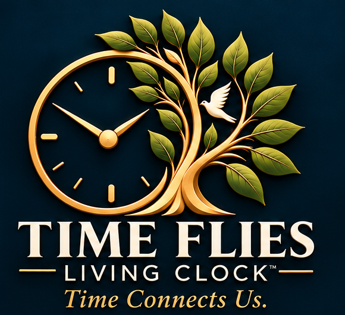

  

<h1 align="center">Time Flies: Living Clock™</h1>

<em>Time Connects Us.</em>

  <strong>A beautiful, always-on clock for iPad, set in a living window of real weather.</strong> 
  Always On. Always Beautiful. Always Ad-Free.

  <a href="https://timeflies.live"><strong>timeflies.live</strong></a> ·
  <a href="#coming-soon">Coming Soon to the App Store</a> ·
  <a href="docs/features.md">Features</a> ·
  <a href="docs/roadmap.md">Roadmap</a> ·
  <a href="docs/faq.md">FAQ</a> ·
  <a href="../../discussions">Discussions</a>

---

> **About this repository.** This is the public showcase for Time Flies: Living Clock™. It holds product information, screenshots, the roadmap, and our community discussions. The app itself is proprietary, and its source code is not published here.

## What is Time Flies?

Time Flies turns your iPad into a calm, full-screen clock that stays on while the app is open. Behind the clock is a mountain-cabin window: rain runs down the glass, snow drifts past the pines, and the light changes from sunrise to moonlight. Set it on a nightstand, kitchen counter, or desk and let it run.

- **Always-on clock.** Large, full-screen, and fully customizable.
- **Living window scenery.** Framed or frameless, with lighting that follows the day.
- **Live local weather.** Enter a ZIP code and the scene follows your real weather, with no GPS needed.
- **Weather Preview.** See sunny, rain, snow, thunderstorm, moonlight, and sunset scenes any time.
- **Nightstand Mode.** A dimmed, minimal clock for the bedroom.
- **100% ad-free.** No ads on any plan, including the free one.

See the complete list in [docs/features.md](docs/features.md).

## Screenshots

Final iPad screenshots will be added here once the scenery artwork is final. See [assets/screenshots](assets/screenshots/).

## Follow development

| Milestone | Status |
|---|---|
| Foundation | ✅ Complete |
| Always-On Clock | ✅ Complete |
| Mountain Cabin Experience | ✅ Complete |
| Live Weather and Preview | 🧪 In testing |
| Official Weather Alerts | 🔜 Up next |
| Pro features | 🗓️ Planned |

Full details are in the [roadmap](docs/roadmap.md) and the [changelog](CHANGELOG.md).

## Join the conversation

We use **GitHub Discussions** to hear from you, without any app code involved.

- 💡 **[Ideas](../../discussions/categories/ideas):** suggest a feature, scene, or holiday theme
- ❓ **[Q&A](../../discussions/categories/q-a):** ask anything about the app
- 🖼️ **[Show and Tell](../../discussions/categories/show-and-tell):** tell us where your clock will live
- 📣 **[Announcements](../../discussions/categories/announcements):** development updates and launch news

Please read our [Community Guidelines](CODE_OF_CONDUCT.md) before posting.

## Coming soon

Time Flies: Living Clock™ is in active development for iPad (iPadOS 17 or later). It will be available on the App Store. Visit **[timeflies.live](https://timeflies.live)**, and watch the [Announcements](../../discussions/categories/announcements) category to hear first.

## Privacy

- No advertising and no advertising tracking
- No account required to use the clock
- No GPS: weather uses the ZIP code you enter
- Your settings are stored on your iPad

A full privacy policy will be published before launch.

## Contact

Email Time Flies at **[timefliesbyfiretext@gmail.com](mailto:timefliesbyfiretext@gmail.com)**, or start a conversation in [Discussions](../../discussions).

## Security

Found a security concern? Please follow [SECURITY.md](SECURITY.md). Do not post it publicly.

## License

The contents of this repository, including the name, logo, artwork, text, and website, are © FireTEXT® Dispatch Solutions Inc. All rights reserved. See [LICENSE.md](LICENSE.md).

---

  <strong>Time Flies: Living Clock™</strong> 
  A 411 Community Experience · Developed by FireTEXT® Dispatch Solutions

“Time Flies: Living Clock” is a working brand name and is not a registered trademark. FireTEXT® is a registered trademark of FireTEXT® Dispatch Solutions Inc. iPad and App Store are trademarks of Apple Inc.
